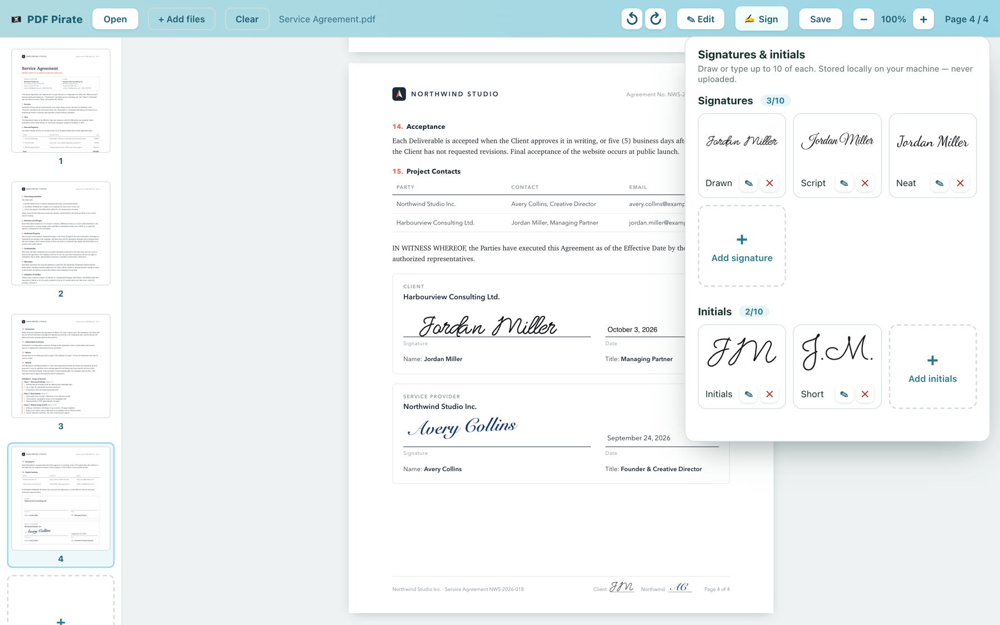
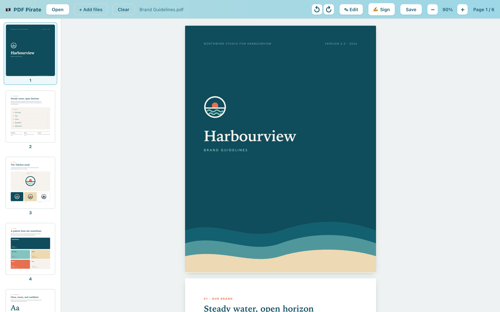
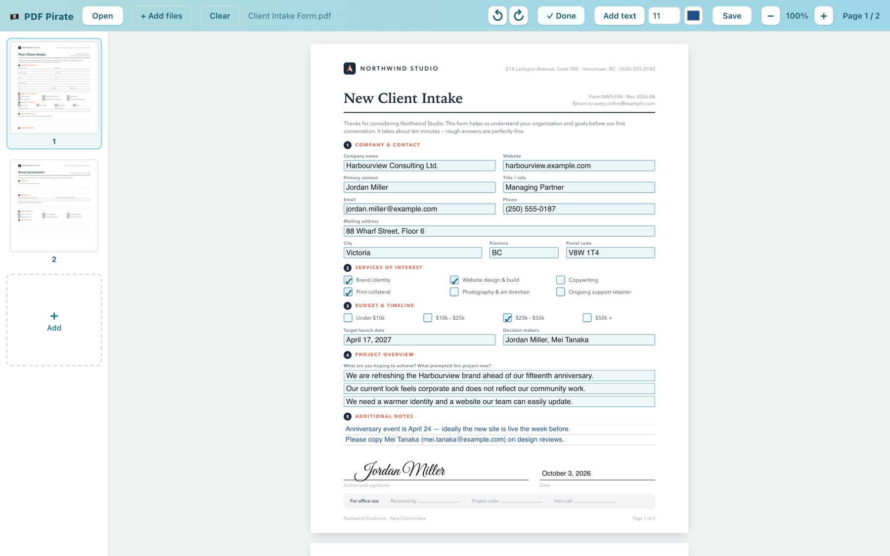
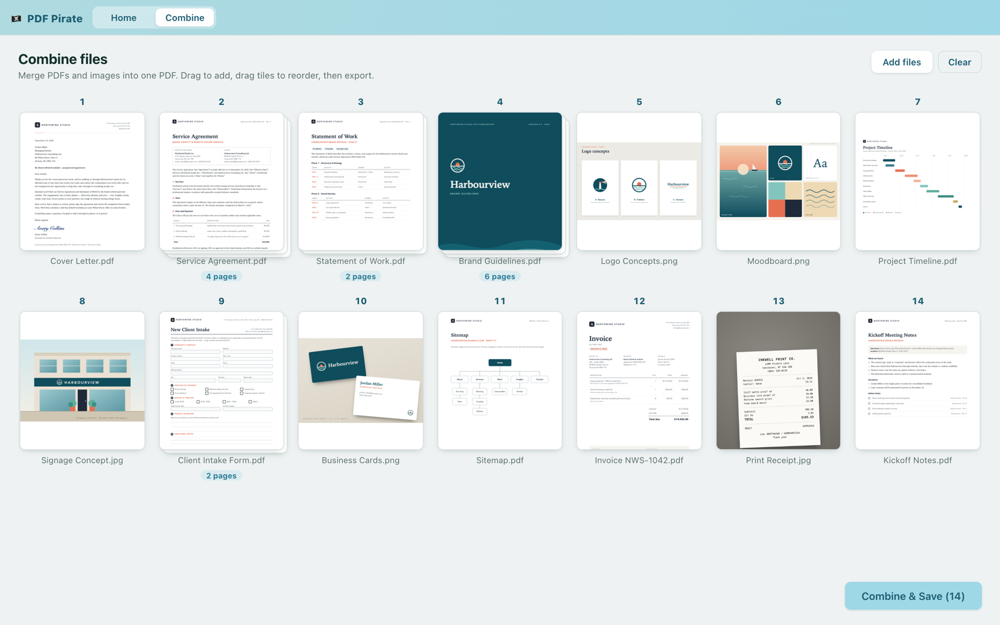
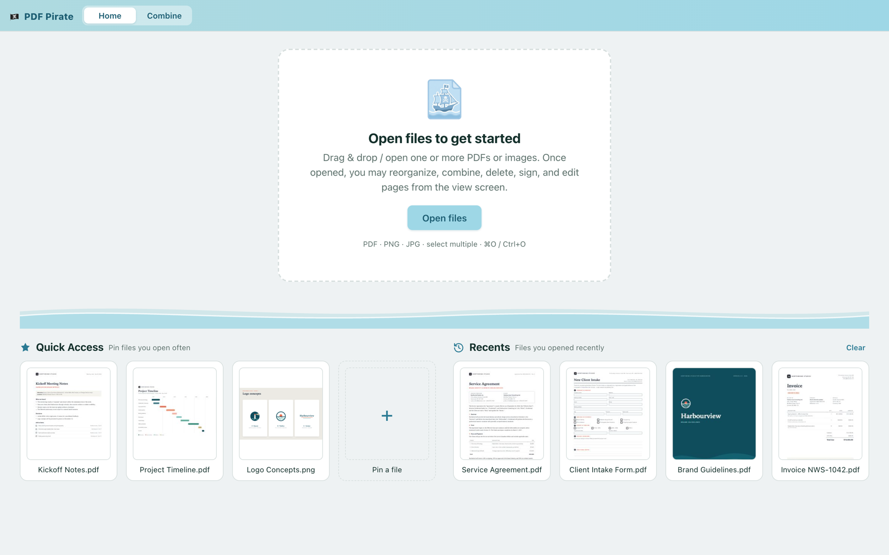

<p align="center">
  
</p>

<h1 align="center">PDF Pirate</h1>

<p align="center">
  A free, open-source PDF viewer, editor, signer and combiner for Windows and macOS.<br />
  Everything happens on your computer. No account, no uploads, no subscription.
</p>

<p align="center">
  
</p>

## Download

**[Get the latest release →](https://github.com/pdfpirate/PDF-Pirate/releases/latest)**

| Platform | File |
| --- | --- |
| macOS, Apple Silicon | `PDF-Pirate-<version>-arm64.dmg` |
| macOS, Intel | `PDF-Pirate-<version>-x64.dmg` |
| Windows 10 and 11 | `PDF-Pirate-Setup-<version>.exe` |

PDF Pirate isn't signed with a paid Apple or Microsoft certificate yet, so the first time you open it your computer will ask you to confirm. On macOS, open **System Settings → Privacy & Security** and click **Open Anyway**. On Windows, click **More info → Run anyway**.

## Why

I needed to sign a PDF on a computer that didn't have Adobe installed. Rather than pay for a subscription or upload a private document to a website, I built my own.

## Features

- **View** PDFs and images (PNG, JPG) with page thumbnails, zoom and rotation
- **Organize** pages: reorder, rotate and delete
- **Fill** in form fields, and add text boxes anywhere with your choice of size and colour
- **Sign** with a drawn signature or one typed in a handwriting font. Save up to 10 signatures and 10 sets of initials, then place them with a click (hold <kbd>Alt</kbd>/<kbd>Option</kbd> and scroll to resize)
- **Combine** any mix of PDFs and images into a single PDF, in the order you choose
- **Quick Access and Recents** keep the files you use most one click away
- **Private by design**: files and saved signatures never leave your machine

## Screenshots

| | |
| :---: | :---: |
|  |  |
| Viewing with page thumbnails | Filling in a form |
|  |  |
| Combining PDFs and images | Quick Access and Recents |

<sub>Screenshots use sample documents.</sub>

## Getting started

You'll need [Node.js](https://nodejs.org) 20 (see `.nvmrc`).

```bash
npm install
npm run dev
```

### Build the app

```bash
npm run build:mac   # macOS (.dmg)
npm run build:win   # Windows (.exe)
```

Installers are written to `dist/`.

## Built with

[Electron](https://www.electronjs.org) · [React](https://react.dev) · [TypeScript](https://www.typescriptlang.org) · [pdf-lib](https://pdf-lib.js.org) · [PDF.js](https://mozilla.github.io/pdf.js/) · [electron-vite](https://electron-vite.org)

## License

[MIT](LICENSE)

---

<p align="center">Made by <a href="https://matthewzeitler.com">Matthew Zeitler</a></p>
